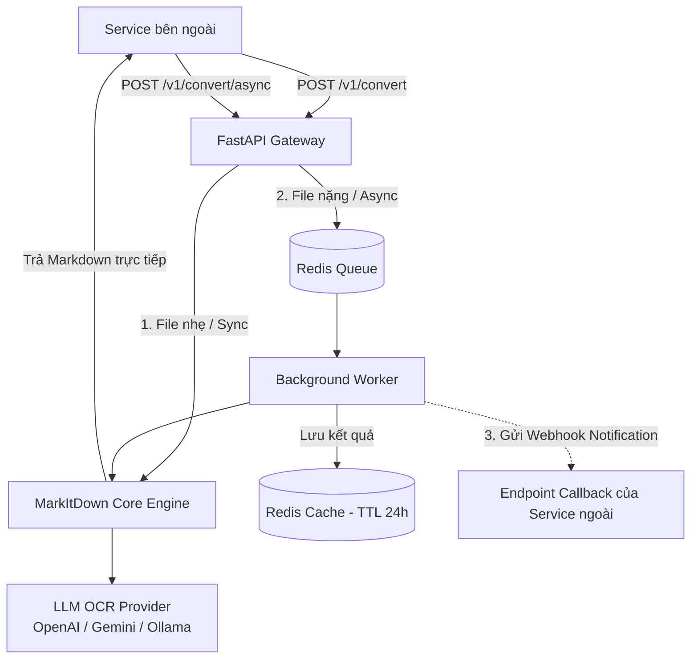

# Tài Liệu Yêu Cầu Kỹ Thuật (SRS): MarkItDown Conversion & OCR Service

> **Nguồn tham khảo chính thức:** [microsoft/markitdown (GitHub)](https://github.com/microsoft/markitdown)

## 1. Tổng quan & Mục tiêu Dự án
Xây dựng một microservice hiệu năng cao để chuyển đổi các loại tệp tài liệu đa định dạng sang Markdown, tích hợp khả năng OCR thông minh bằng Vision LLM dựa trên thư viện chính thức của Microsoft (`markitdown` và `markitdown-ocr`), hỗ trợ cả hai phương thức xử lý: đồng bộ (Sync) và bất đồng bộ qua hàng đợi (Async Queue) với cơ chế thông báo chủ động (Webhook Callback).

### Các định dạng tài liệu hỗ trợ:
- **Văn bản & Bảng tính**: PDF, DOCX, PPTX, XLSX, CSV, HTML, TXT, EPUB.
- **Hình ảnh (hỗ trợ OCR qua LLM)**: PNG, JPG, JPEG, WEBP.
- **Đa phương tiện**: MP3, WAV (trích xuất metadata/transcription nếu cấu hình thêm).

---

## 2. Kiến trúc Đóng gói (Docker Containerization)

### Đánh giá Docker Image `mcp/markitdown`
- **Kết luận:** Image chính thức `mcp/markitdown` **KHÔNG ĐỦ** tính năng và không phù hợp với mục tiêu làm HTTP Microservice.
- **Lý do:** `mcp/markitdown` được tạo riêng cho giao thức Model Context Protocol (MCP) phục vụ các AI client (như Claude Desktop, Cursor) qua stdio/SSE; không cung cấp HTTP REST endpoint, không hỗ trợ truyền dynamic API Key linh hoạt cho từng request từ bên ngoài, và không có hệ thống quản lý hàng đợi.

### Giải pháp Container hóa:
- **Tự xây dựng Custom Docker Image**:
  - **Base Image:** `python:3.11-slim` (hoặc `python:3.12-slim`).
  - **Dependencies hệ điều hành:** `poppler-utils` (xử lý render PDF), `ffmpeg` (xử lý media), `libgl1`.
  - **Web Framework:** `FastAPI` + `Uvicorn` (asynchronous, tài liệu OpenAPI Swagger tự động).
  - **Quản lý tác vụ ngầm (Worker):** `Celery` hoặc `ARQ` chạy kèm Redis.
- **Triển khai qua Docker Compose:**
  - `web`: Chạy FastAPI server phục vụ REST API.
  - `worker`: Chạy Celery/ARQ Worker xử lý convert tài liệu nặng và gọi Webhook.
  - `redis`: Message Broker cho queue và lưu trữ kết quả tạm thời (TTL 24h).

---

## 3. Cơ chế OCR & Tích hợp LLM

- **Thư viện chính thức từ Microsoft:**
  - `markitdown`: Gói lõi xử lý định dạng file.
  - `markitdown-ocr`: Plugin OCR chính thức của Microsoft (`packages/markitdown-ocr`), kích hoạt bằng flag `enable_plugins=True`.
- **Nguyên lý hoạt động của `markitdown-ocr`:**
  - Không phụ thuộc vào các binary OCR truyền thống nặng nề (như Tesseract), mà sử dụng trực tiếp **LLM Vision** thông qua `llm_client` (OpenAI-compatible) và `llm_model` để trích xuất chữ từ ảnh nhúng và các trang scan trong PDF, DOCX, PPTX, XLSX.
- **Hỗ trợ đa nhà cung cấp (OpenAI-compatible):**
  - Mặc định tương thích: OpenAI (`gpt-4o`, `gpt-4o-mini`), Google Gemini (qua OpenAI compatibility endpoint), Azure OpenAI, Groq, DeepSeek, OpenRouter, và Local LLM (Ollama / vLLM với Qwen2.5-VL hoặc LLaVA).
- **Cơ chế BYOK (Bring Your Own Key):**
  - Cho phép client truyền thông tin xác thực qua HTTP Headers trong từng request:
    - `X-LLM-Api-Key`: API Key của LLM.
    - `X-LLM-Base-Url`: *(Tùy chọn)* Endpoint URL (ví dụ: `https://api.openai.com/v1` hoặc `http://host.docker.internal:11434/v1`).
    - `X-LLM-Model`: *(Tùy chọn)* Tên model (ví dụ: `gpt-4o`, `gpt-4o-mini`, `gemini-1.5-flash`).
  - Nếu request không truyền header, hệ thống sẽ fallback về cấu hình mặc định khai báo trong biến môi trường của container (`OPENAI_API_KEY`, `DEFAULT_LLM_MODEL`).

---

## 4. Đặc tả Giao thức HTTP REST & Hàng đợi (Queue)

Hệ thống hỗ trợ 2 chế độ xử lý tùy theo kích thước và tính chất của tài liệu:



### 4.1. Chế độ Đồng bộ (Synchronous Mode)
Dành cho file dung lượng nhỏ (Word, Excel nhẹ, văn bản thuần hoặc PDF có sẵn text layer):
- **Method:** `POST /v1/convert`
- **Content-Type:** `multipart/form-data`
- **Params:** `file` (bắt buộc).
- **Response:** `200 OK`
```json
{
  "status": "success",
  "filename": "document.docx",
  "result": {
    "markdown": "# Tiêu đề tài liệu\n\nNội dung văn bản...",
    "char_count": 1250
  },
  "duration_seconds": 0.45
}
```

---

### 4.2. Chế độ Bất đồng bộ có Webhook Callback (Asynchronous Mode)
Dành cho tài liệu dung lượng lớn, scanned PDF nhiều trang, file âm thanh hoặc hệ thống cần xếp hàng:
- **Method:** `POST /v1/convert/async`
- **Content-Type:** `multipart/form-data`
- **Form Fields:**
  - `file`: File cần xử lý (Bắt buộc).
  - `callback_url`: URL của service ngoài để nhận notification khi xử lý xong (Tùy chọn).
  - `callback_secret`: Chuỗi bí mật dùng để tạo chữ ký HMAC xác thực (Tùy chọn).
  - `callback_headers`: JSON string chứa các header cần thiết (ví dụ token Authorization) khi bắn webhook (Tùy chọn).
  - `custom_metadata`: JSON string chứa thông tin nghiệp vụ của service ngoài (ví dụ `{"doc_id": "ABC-123"}`). Dữ liệu này sẽ được trả nguyên vẹn trong callback (Tùy chọn).
- **Phản hồi tức thì:** `202 Accepted`
```json
{
  "status": "queued",
  "task_id": "8f4c2c51-8742-4b2a-bf35-979f53e34279",
  "message": "Tác vụ đã được đưa vào hàng đợi xử lý."
}
```

---

### 4.3. Đặc tả Webhook Notification (Callback)
Khi worker hoàn thành tác vụ (thành công hoặc thất bại), hệ thống sẽ gửi một request `POST` đến `callback_url`.

#### Headers gửi kèm trong Webhook:
```http
Content-Type: application/json
X-MarkItDown-Event: task.completed
X-MarkItDown-Task-Id: 8f4c2c51-8742-4b2a-bf35-979f53e34279
X-MarkItDown-Signature: sha256=<HMAC-SHA256 signature calculated with callback_secret>
```

#### Body khi Xử lý Thành công (`task.completed`):
```json
{
  "event": "task.completed",
  "task_id": "8f4c2c51-8742-4b2a-bf35-979f53e34279",
  "status": "completed",
  "filename": "scan_contract.pdf",
  "result": {
    "markdown": "# HỢP ĐỒNG KINH TẾ\n\nNội dung đã được OCR thành công...",
    "char_count": 4820
  },
  "custom_metadata": {
    "doc_id": "ABC-123"
  },
  "metrics": {
    "queued_at": "2026-11-01T11:15:00Z",
    "completed_at": "2026-11-01T11:15:22Z",
    "duration_seconds": 22.1
  }
}
```

#### Body khi Xử lý Thất bại (`task.failed`):
```json
{
  "event": "task.failed",
  "task_id": "8f4c2c51-8742-4b2a-bf35-979f53e34279",
  "status": "failed",
  "filename": "damaged_file.pdf",
  "error": {
    "code": "CONVERSION_ERROR",
    "message": "File PDF bị hỏng hoặc định dạng không được hỗ trợ."
  },
  "custom_metadata": {
    "doc_id": "ABC-123"
  }
}
```

#### Chính sách Đảm bảo Độ Tin Cậy (Retry & Reliability):
1. **Exponential Backoff Retry:** Nếu `callback_url` phản hồi lỗi (HTTP status `>= 400`) hoặc timeout (sau 10s), worker sẽ tự động retry tối đa 3-5 lần (khoảng cách sau 5s, 30s, 2m, 10m).
2. **Ký số bảo mật (HMAC Signature):** Service ngoài dùng `callback_secret` để tính toán lại chữ ký HMAC SHA-256 đối chiếu với `X-MarkItDown-Signature`, chống giả mạo request.
3. **Fallback Polling:** Kết quả luôn được lưu tạm trong Redis trong 24 giờ. Service ngoài có thể chủ động gọi `GET /v1/tasks/{task_id}` để tra cứu trạng thái nếu webhook gặp sự cố mạng.

---

### 4.4. Các Endpoint Bổ trợ
- `GET /v1/tasks/{task_id}`: Lấy trạng thái và kết quả chuyển đổi của task trong queue.
- `GET /health`: Healthcheck phục vụ kiểm tra trạng thái hoạt động của Service và Redis connection.
- `GET /docs`: Swagger UI tương tác trực tiếp với API.

---

## 5. Kế hoạch Triển khai (Roadmap)

1. **Giai đoạn 1: Core Engine & Sync API**
   - Khởi tạo project FastAPI, cài đặt `markitdown` và các thư viện hỗ trợ.
   - Xây dựng module nhận dynamic LLM configuration (BYOK) từ header.
   - Hoàn thiện endpoint đồng bộ `/v1/convert`.
2. **Giai đoạn 2: Scanned PDF & OCR LLM Enhancement**
   - Xử lý pipeline nhận diện và OCR trang PDF dạng scan bằng Vision LLM.
3. **Giai đoạn 3: Redis Queue & Webhook Callback**
   - Cài đặt Redis và cấu hình Celery/ARQ Worker.
   - Xây dựng endpoint `/v1/convert/async` và cơ chế gửi Webhook có HMAC + Retry policy.
4. **Giai đoạn 4: Đóng gói & Hoàn thiện**
   - Viết `Dockerfile` tối ưu nhiều tầng (multi-stage build).
   - Viết file `docker-compose.yml` (FastAPI + Worker + Redis).
   - Viết tài liệu hướng dẫn sử dụng và kiểm thử tải.
